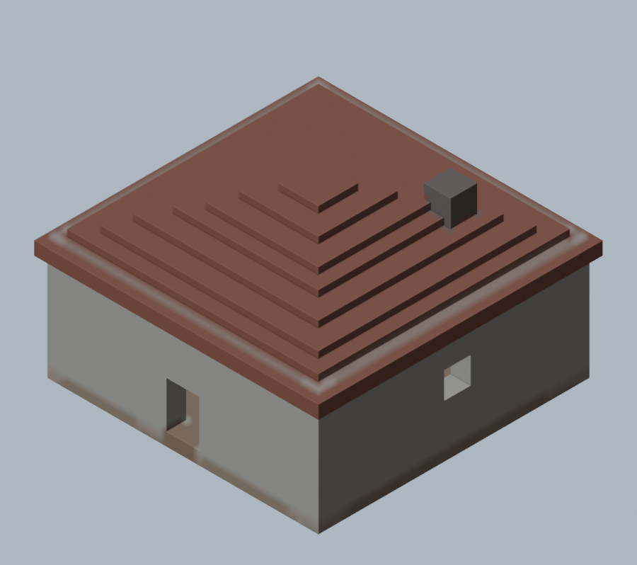
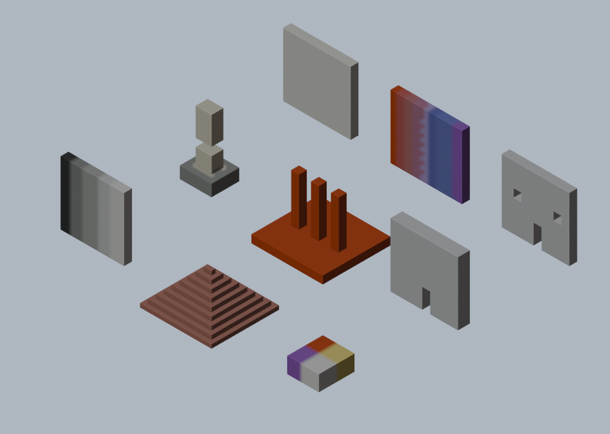

# Blender MC Voxel

**把 Blender 模型一键体素化成 Minecraft 建筑。** 只导出 `.litematic`（Litematica 投影）一种格式。配色不是拍脑袋的色表，而是直接读你客户端 jar 里的真实方块平均色。



> 状态：在 **Blender 5.2.2 LTS** 实机验收通过（57 项），`pytest` **220 项**全绿，导出结果在 **MC 26.3 + Fabric + Litematica 0.29.1** 游戏内 Load 成功。

## 功能一览

| 能力 | 说明 |
|---|---|
| **体素化** | 三角形-体素 16 轴 SAT，斜面和尖角不糊；按覆盖尺寸分组批量算，4000+ 三角形的模型秒级出结果 |
| **导出 .litematic** | Litematica 投影，游戏里按 `M` → Load Schematic 直接用；多 region、带元数据 |
| **真实方块配色** | 直接读客户端 jar：1288 个 blockstate → 筛出 **412 种**整方块，按 CIE Lab ΔE76 最近邻匹配 |
| **纹理感知匹配** | 平涂的面配平纹理方块、有噪点的面配有噪点的方块，光面上不会突然冒出矿石斑点 |
| **尺寸控制** | 直接给方块尺寸（1 体素 = N 米），或反过来「我要它高 200 格」自动反算倍率 |
| **世界限高** | 主世界 / 下界 / 末地的高度上限从 jar 的 `dimension_type` 读，超限自动压倍率或拦下并给出改法 |
| **重力方块保护** | 悬空的沙子 / 沙砾 / 混凝土粉末自动换成近似色，投影摆出去不会塌成一地 |
| **白名单 / 禁用** | 只用某几种方块，或剔掉不想要的（支持 `*` 通配、面板内搜索添加，不用背 id） |
| **等距预览图** | 不出 Blender 就能看游戏里大概什么样：正交相机 + 真实方块色 + 接触阴影 |
| **超上限自动分块** | 模型太大时按最长轴切成几段分别体素化、分别导出，峰值内存只按单段算；格子严格对齐，拼回去不错位 |
| **噪声去单调** | 大面积同色墙按比例混入次近方块，打散塑料感；由坐标哈希决定，同一模型每次导出结果一致 |
| **方块种类上限** | 默认 24 种。超过就把用得最少的并到颜色最接近的保留方块——Litematica 每种方块单独建缓存，种类越多加载越慢 |
| **照明方块开关** | 蛙鸣灯、菌光体、海晶灯这类「放下就亮」的方块可以一键排除，做夜景灯带时再打开（默认开） |
| **批量导出** | 选一个目录，场景里每个网格物体各导一个投影，单个失败不影响整批 |
| **可脱离 Blender** | `core/` 除 `mesh_data.py` 外不 import bpy，整套测试和导出都能在纯 Python 里跑 |

## 安装

### 需要什么

| 项 | 要求 |
|---|---|
| Blender | **5.2.2 LTS 或更高**（`blender_manifest.toml` 里 `blender_version_min = 5.0.0`，低于 5.0 装不上） |
| Python | 不用自己装，Blender 自带；核心算法只依赖 numpy（Blender 内置） |
| 客户端 jar | 可选，但**强烈建议**：有它才有真实 300 色配色；没有会退到内置 96 色，颜色明显偏 |
| 游戏侧 | Minecraft + [Litematica](https://modrinth.com/mod/litematica)（Load `.litematic` 用）；推荐 MC 26.3 + **Litematica 0.29.1 或更高** |

### 推荐版本

| 组件 | 版本 | 验证到什么程度 |
|---|---|---|
| **Blender** | **5.2.2 LTS 或更高** | 面板操作与 `tools/blender_m1.py` 真机 57 项均在 5.2.2 LTS 上完成；更高版本可正常安装 |
| **Minecraft** | **26.3**（须与客户端 jar 对应） | 导出的 `.litematic` 在游戏内 Load 成功，形状 / 空心 / 开口 / 分层均已核对 |
| **模组加载器** | **Fabric 0.20.1 或更高** | 仅影响 Litematica 的安装，与导出文件无关；Forge / NeoForge 同样适用 |
| **Litematica** | **0.29.1 或更高** | 读取上限为 `SCHEMATIC_VERSION = 7`，更高版本均向后兼容；低于 0.29 无法读取 |

除 MC 版本需与客户端 jar 对应外，其余组件均为「该版本或更高即可」。

上表所列组合已通过完整验收（`pytest` 220 项、端到端 19 项、Blender 真机验收）。其他版本组合尚未进行全量测试，使用前建议先以 `examples/05_bugtest.blend` 导出并在游戏内 Load，确认格式与方块映射正常。

### 方式一：装发布包（普通用户）

1. 下载 `mc_voxel_export.zip`（[Releases](https://github.com/liz854/blender-mc-voxel/releases) 页）
2. Blender → `Edit` → `Preferences` → `Add-ons` → 右上角 `▾` → **Install from Disk…**
3. 选那个 zip，确认列表里 **Blender MC Voxel** 已勾选

### 方式二：从源码打包（开发者）

```bash
git clone https://github.com/liz854/blender-mc-voxel.git
cd blender-mc-voxel
python tools/pack.py                         # 产出 dist/mc_voxel_export.zip
blender.exe --command extension install-file -r user_default -e dist/mc_voxel_export.zip
```

改完代码重跑这两条就是覆盖安装，不用手动删旧版。

### 确认装好了

3D 视图按 `N`，侧栏**最右边那一列竖排标签**里出现 **MC 体素**（`N` 弹出的 X/Y/Z 是 Blender 自带的物体变换面板，不是本扩展）。
嫌不好找就用顶部菜单栏的 **MC 体素**，或右键物体 → **MC 体素** → **打开 MC 体素面板**，面板会弹成浮窗。

装好后第一次体素化，Console 里应该能看到一行：

```
[mc_voxel] 资源包方块 412 种（26.3-Fabric 0.20.1.jar）
```

数字不对或显示「用兜底 96 色」，就是没找到客户端 jar，见下面「快速上手」第 3 条。

### 更新 / 卸载

- **更新**：重新 Install from Disk 同一个包会直接覆盖（Blender 输出 `Reinstalled "mc_voxel_export"`）
- **卸载**：Add-ons 列表里取消勾选，或右上角 `▾` → Uninstall
- 色板缓存在扩展的用户目录，卸载不会删；想强制重建就删掉 `block_colors.json`，或换一个 jar

## 快速上手

面板只放常用的东西，四步出结果：

1. **选中网格物体**（没有顶点色会全白，先涂色或看 `examples/`）
2. 点 **建筑 / 像素画 / 地形** 套预设。不满意就直接拖 **方块尺寸**（1 格 = N 米）：
   10×10×10 的立方体配 1.0 → 1000 个方块
   想按尺寸反着来也行——选 **高 / 长 / 宽** 某一轴，填 **目标格数**，点 **定倍率**
3. 点 **导出投影（.litematic）**
4. 面板底部出现「上次导出」，点 **打开所在文件夹** 直接定位到文件

> 只想看看会变成什么样，点 **只看统计** 或 **方块预览**，不落盘。

**色板、世界限高、分块、噪声、作者、预览图设置全在下面折叠的「高级设置」里**，第一次用完全不用碰——
客户端 jar 会自动找，游戏版本默认 26.3，导出的 DataVersion 直接对得上。

导出后把 `.litematic` 丢进 `.minecraft/schematics/`，游戏里按 `M` → Load Schematic。

### 面板长什么样

| 位置 | 放什么 |
|---|---|
| **台面上**（主面板） | 选中提示、三个预设、方块尺寸、定倍率、导出 / 只看统计 / 方块预览、上次导出回读 |
| **高级设置**（默认折叠） | 实心填充、重力方块、允许照明方块、方块种类上限、噪声、维度与限高、客户端 jar、游戏版本、DataVersion、只用/禁用方块、自动分块、方块上限、区域大小、作者、批量导出、预览图 |

### 预设

三个按钮一键套参数：

| 预设 | 方块尺寸 | 实心 | 方块种类上限 | 适合 |
|---|---|---|---|---|
| 建筑 | 1.0 m | 否（只留外壳） | **24 种** | 一比一的房子、雕塑 |
| 像素画 | 0.2 m | 否（只留外壳） | **48 种** | 平面画、贴面 |
| 地形 | 4.0 m | 否（只留外壳） | **12 种** | 大范围地貌，方块少、拖得动 |

三个预设**都是空心**。实心只在「高级设置 → 效果 → 实心填充」里手动开——见下面那节。

方块种类上限也是按用途给的默认值，**面板上随时能改**（高级设置 → 效果）：
建筑讲究材质层次给 24；像素画的颜色本身就是内容，压狠了会失真所以给 48；
地形看的是大色块，12 种就够，也最省 Litematica 的加载时间。

### 倍率：从长度反算

不想手工试 0.05 还是 0.08，就直接说"我要它高 200 格"：

1. 下拉选 **高（Y）/ 长（X）/ 宽（Z）**
2. **目标格数** 填 200
3. 点 **定倍率**

方块尺寸 = 这一轴的实际长度 ÷ 目标格数，写回面板，后面的体素化和导出都用它。例如 55 m 高的猴头要 40 格高 → 55 ÷ 40 = 1.375 m 一格，体素化出来正好 40 格。

反算出来的倍率如果会让高度超限高（比如只限制了"长 64 格"，但模型又瘦又高），会按下面的规则自动压到限高内。

### 白名单与禁用

面板上是两个文本框，填的就是**方块 id**（`stone`、`oak_planks`、`glass` 这种），语法一样：逗号、分号、空格、换行都能分隔，中英文标点都认。

```
只用这些：minecraft:stone, deepslate, *wool*
禁用：glass, water; sand
```

- 不带 `minecraft:` 前缀会自动补（`glass` → `minecraft:glass`）
- 支持 `*` / `?` 通配，按当前色板展开
- **白名单**只在这几种里选色；**禁用**从候选池里剔掉，两者可以同时用，禁用优先
- **都不会留空洞**：过滤后重建 Lab LUT，原位置落到色差最小的可用方块。禁掉 `stone` 之后那块变成 `snow_block`，方块总数一个不少
- 全禁光会直接报错，不会静默输出一堆空气

侧栏那一列很窄，单行输入框里长一点的内容就只剩省略号，看不清自己填了什么。所以每个框下面都有：

| 按钮 | 干什么 |
|---|---|
| **搜索添加** | 弹搜索框，从当前色板里输入片段（`wool` / `concrete` / `stone`）挑一个，自动补全 `minecraft:` 前缀并追加到框里，不用背 id |
| **清空** | 清掉这个框 |
| 输入框下面那行 「生效 …」 | 直接回读解析结果，`*wool*` 展开成哪几种都列出来，前 4 个显示名字、后面给总数 |
| 右侧放大镜 | 弹窗列出**全部**生效方块（比侧栏宽），以及哪些名字在当前色板里找不到 |

### 纹理感知匹配

只按平均色匹配会有个毛病：一面纯色的墙，色差最小的方块可能带着斑点纹理（矿石、粗金属块），放大到 1 米一格后整面墙都在闪。所以匹配成本加了一项：

```
cost = ΔE76(色差) + 1.0 × |std_方块 − std_目标|
```

`std` 是纹理像素的颜色标准差（纯色方块 ≈ 0-5，石头类噪点 20-30，花纹理 35+，超过 42 的不进色板）。目标 std 取模型那一块区域的局部颜色方差，量化成 4 档（中心 4 / 14 / 27.5 / 47.5），每档预先建一张 32³ LUT——ΔE 矩阵只算一次，四档共用，构建开销可以忽略。

**关键设计：目标 std 必须按颜色分组取 25% 分位，不能按体素直接取。** 颜色分界处的体素，3³ 邻域横跨两种颜色，std 会被自然抬高，按体素取就会把整条分界线判成"粗糙"，结果墙色交界处冒出一圈斑点方块（T6 灰阶、T8 四原色实测都踩到了）。同色区域内边界体素是少数，取低分位就能整体判"平"。

对导出的实际影响（`tools/bugtest_export.py` 重导前后对比）：

| 测试块 | 改前 | 改后 |
|---|---|---|
| T8 四原色 | 黄色被拆成羊毛 + 金块 + 紫水晶三种 | **四象限各 64 块，各一种方块** |
| T3 / T3B 挖洞墙 | 白混凝土混萤光石、闪长岩 | **476 / 492 块全是一种白混凝土** |
| T7 金字塔 | 红陶瓦 + 两种朱砂混拼 | **935 块全是一种红陶瓦** |
| T6 五级灰阶 | 每级混入矿石 | 每级一种，无矿石 |

色板没有纹理信息时（兜底 96 色、工具脚本直接传 `colors`）这一项自动关闭，行为与改前完全一致，性能零开销（200³ 实测 16.49s，改前 16.5s）。想手动关掉：`build_voxel_model(..., texture_match=False)`。

### 重力方块支撑

沙子、沙砾、混凝土粉末这些放下会掉的方块，**下方没有实心方块托着就不许用**，换成色差最小的非重力方块（沙 → 砂岩那种）。不这么做的话，投影摆出去会塌成一地沙子。

判定要往下追到底：**沙托沙不算托**。整根悬空沙柱会被全部换掉——Litematica 施工不保证严格从下往上摆，只换最底下那格的话，先放上面那格照样塌。非重力方块不受影响，悬挑、桥、拱照留。

面板上「悬空禁用重力方块」默认开。验证样本：`python tools/gravity_demo.py`（左侧悬空沙柱三格全换、右侧石头托着的两格保留）。

### 单位与缩放

约定 **1 体素 = 1 方块 = 1 米**。导出时顶点会依次乘上：

1. 物体自身的 `matrix_world`（位移 / 旋转 / 缩放）
2. 场景的 `unit_settings.scale_length`（1 BU 等于多少米）

所以把 Suzanne 放大两倍再体素化，方块数会真的变成 8 倍；场景单位设成厘米也不会导出一个缩水 100 倍的投影。两者非默认值时 Console 会打印换算信息。

### 限高（世界高度）

MC 有世界高度上限，**超出的方块 Litematica 摆投影时会静默跳过**——不报错、不提示，就是缺了头或少半截。所以导出前会拦：

| 维度 | y 范围 | 限高 |
|---|---|---|
| 主世界 | -64 … 319 | **384 格** |
| 下界 | 0 … 255 | 256 格（`logical_height` 只有 128） |
| 末地 | 0 … 255 | 256 格 |

数值不是写死的：给了客户端 jar 就从 `data/minecraft/dimension_type/*.json` 读（缓存按 jar 的 mtime 失效），读不到才用内置兜底。也就是说改过世界高度的 mod / 数据包，只要 jar 里是对的就跟着对。

**倍率会自动压到限高内**：面板「自动压到限高内」默认开。算出来会超限高时，先把方块尺寸放大到刚好塞得下（`格数 = ceil(原始高度 ÷ 方块尺寸)` 可以直接反解，不用先体素化一遍），再把实际用的值写回面板——所以你看到的就是真实生效的倍率，不会出现"我明明设了 1.0，导出却是 1.0412"的困惑。关掉它就退回旧行为：严格限高直接报错。

判定分三档：

- **放得下**：直接过
- **放得下但得从地下起建**：主世界地面在 y=63，往上只有 257 格。模型高过 257 就告警，告诉你得往下埋 `高度 − 257` 格
- **超限高**：直接中止，并给出两条出路——把方块尺寸调到多少（例：400 格高、当前 1.0 → 调到 1.05），或者沿高度拆成几段分别导出

面板「维度」下面实时显示当前维度的 y 范围和地面以上可用格数。用改高度的整合包时可以把「严格限高」关掉，关掉只告警不拦。

### MC 朝向

面板「导出」区直接标着 **+X 东、+Y 北、+Z 上**（Blender 坐标 → Minecraft 朝向）。
转换是 `bl(x,y,z) → mc(x, z, -y)`，所以 Blender 的 +Y 对应 Minecraft 的北。摆投影时朝向搞反很常见，照这行摆。

### 打散单调：噪声

大面积同一颜色的墙，全用一种方块会显得很假。面板「噪声」拉高（0-100%），就会在**同色区域里按比例换成第二接近的方块**：

| 噪声 | 效果 |
|---|---|
| 0%（默认） | 永远选色差最小的那个，结果完全确定 |
| 20-40% | 混入少量近似色，破掉塑料感（推荐） |
| 60% 以上 | 一半以上是次优方块，可能出现明显色斑 |

选谁由**体素坐标的哈希**决定，不是随机数——同一个模型导出几次结果都一样，不会"每次都不一样"。
噪声只换方块种类，**方块总数一格不变**（实测 64 个方块，噪声 0/30/60 依次是 1/2/2 种方块）。

### 批量导出全部网格

点「批量导出全部网格」选一个目录，场景里每个网格物体各导一个文件（文件名 = 物体名，非法字符自动替换）。
单个物体失败不打断整批，最后弹框汇总成功几个、失败几个（失败的明细在 Console）。
物体本身太大时同样会走自动分块，生成 `名字_x1of3.litematic` 这种。

### 照明方块（默认开启）

「高级设置 → 效果 → 允许照明方块」默认**开**。关掉的话下面这些方块不参与匹配，同色位置会落到不发光的近似方块上——做夜景灯带时开着，做素色建筑时关掉更干净。

**自带光、放下就亮的整方块，一共 10 种**，全部在色板里：

| 方块 | 光 | 在色板里？ |
|---|---|---|
| 蛙鸣灯·赭黄 `ochre_froglight` | 15 | ✓ |
| 蛙鸣灯·珠光 `pearlescent_froglight` | 15 | ✓ |
| 蛙鸣灯·青翠 `verdant_froglight` | 15 | ✓ |
| 菌光体 `shroomlight` | 15 | ✓ |
| 哭泣的黑曜石 `crying_obsidian` | 10 | ✓ |
| 海晶灯 `sea_lantern` | 15 | ✓ |
| 萤石 `glowstone` | 15 | ✓ |
| 南瓜灯 `jack_o_lantern` | 15 | ✓ |
| 岩浆块 `magma_block` | 3 | ✓ |
| 信标 `beacon` | 15 | ✓ |

**红石灯、铜灯泡系列不算**——它们要红石信号才亮，不充能就是暗的，选中等于选了个颜色不对的方块。这条有测试钉着。

> 猴头模型的整个脸部一度被 `verdant_froglight` 填满。查下来不是种类上限也不是选区 bug：猴头脸部顶点色本身就接近单一浅灰（原始模型如此），整片同色是必然的；而 `verdant_froglight` 的平均色（211,235,208）恰好贴合浅色平滑面，所以「平均色最接近」这条准则就选到了它。

### 黑名单只挡两种「放下就不对」的

标准只有一个：**放下去之后，它还是不是它**。分两种情况：

| 情况 | 方块 | 为什么 |
|---|---|---|
| **放不进去** | 仙人掌 | 要求四面都不能挨着其他方块，埋进墙里游戏直接拒绝放置 |
| **放进去会变** | 活珊瑚（5 种） | 离开水立刻变成死珊瑚，整块从粉/紫/黄/青变成灰绿。色差算得再准，摆出来也不是那个颜色 |

`dead_*` 那 5 种死珊瑚**保留**——它们本来就是死的，放下去不会再变，颜色是真实的。

**其它一律放出来。** 书架、工作台、熔炉、箱子、南瓜、炼药锅、活塞、信标、命令方块、刷怪笼、树叶、釉面陶瓦、混凝土粉末、虫蚀方块——全都进色板。

- 书架就是书架的纹理，工作台就是它的胶合板色，玻璃熔炉是浅灰的——作为「平均色最接近的方块」完全正当
- 以前挡它们只是因为「这些不是建材」，那是审美判断，不归这个扩展管
- 真觉得某个方块不该出现在你的作品里，用面板的 **「禁用方块」** 自己排除（支持通配符，比如 `*_leaves`）

判定写在 `pack._changes_on_place()`。往那里加新条目之前，先确认「放置后确实会变」——**不能凭想象**。

### 为什么默认是空心

体素化只出**外壳**。实心填充要手动开，原因有三条：

1. **Litematica 会给每个方块建渲染数据**，实心等于把看不见的内部方块也全塞进去。同一个牛油果，实心 44,295 块、空心 10,205 块——差的 34k 全是玩家永远看不到的内部。
2. **施工费材料**。摆投影时内部方块照样要摆，纯浪费。
3. **改起来麻烦**。壳是模型，实心是壳 + 一堆填充物，事后想改结构得先扒掉。

什么时候该开：整体替换地形（把一座山的内部也换成石头）、或者要做剖面图。真需要就开。

### Litematica 加载卡怎么办

如果加载投影卡到动不了（甚至要重启游戏），按这个顺序排查：

| 检查 | 做法 |
|---|---|
| **方块数** | 面板导出后看统计。空心后还上万，就把方块尺寸调大一档（格数减半，方块数差不多减到 1/4） |
| **方块种类** | 高级设置里的「方块种类上限」默认 24。一个灰头盔能选出 69 种灰阶方块，Litematica 要逐种建模型缓存（日志里的 `BlockModelCacheSchematic: refreshing model cache`）；压到 24 种视觉几乎无差，加载快好几倍 |
| **实心填充** | 确认它是关的 |
| **投影放置位置** | 别放在自己脚下或地形里，穿模会让渲染剔除失效 |
| **Litematica 设置** | 关掉「Schematic Verifier（投影比对）」；渲染选项里放宽 "Render Layer Range"，或临时只开一层 |

我们这边能控的是前三条——**空心 + 种类上限 + 调大尺寸**。后两条在游戏侧。

### 模型太大：自动分块

体素网格是稠密的，400³ 就要 7 GB 内存。面板「超上限自动分块」（默认开）在体积超过
2400 万格（约 1.4 GB）时，自动把模型**按最长轴切成几段**，每段独立体素化、独立落盘：

```
house_x1of4.litematic
house_x2of4.litematic
house_x3of4.litematic
house_x4of4.litematic
```

几个关键点：

- **所有段共用同一个 origin 和 block_size**，格子边界严格对齐，拼回去不会错半格
- 跨分界的三角形在相邻两段各有一份，接缝处不会缺面
- 每段独立做内部填充，所以切面要补一层「虚拟封盖」——不补的话，实心模型的中间段会被 flood fill 判成空心（切面上本来就没有表面）。封盖只盖「截面投影里模型真正占用的区域」，实测 4 段拼起来方块数与整体**完全相等**，既不缺也不重
- 段与段首尾相接，摆投影时挨着放即可
- Console 会打一行「网格 43×25×43 超过单段上限，按 X 轴切成 4 段」，想知道切了几段看这里

关掉这个开关就退回旧行为：超过 `max_voxels` 直接报错并告诉你需要多大内存。

### 导出之后会告诉你结果

导出成功后弹一个提示框：写了几个文件、多少方块、尺寸多少，带一个 **打开所在文件夹** 按钮。
面板底部也会留一块「上次导出」回读，弹窗关掉了还能看、还能再点开目录。

> 以前只有状态栏一行字——浮窗面板里基本看不见，很容易以为根本没导出。

### 预览图（看着像游戏里摆出来的样子）

**渲染预览图** 出一张等距（isometric）PNG：正交相机、真实方块平均色、Workbench 的接触阴影和 cavity。不用自己光栅化，也不用手动摆相机。

- 默认 `(1,1,1)` 观察方向、透明关掉、浅蓝灰背景，长边 1024 像素（面板可调 256–4096）
- 画幅按**实际顶点投影**算，不是包围盒八个角——否则尖耳、细尾巴四周会留一大圈空白
- 只画外露面，面数跟表面积走：猴头 55×40×35 是 13400 个面，1 秒出图
- 输出路径留空就放在当前 `.blend` 旁边（没存过则放临时目录），面板填了就用填的
- 渲染完把引擎、分辨率、相机、世界全部还原，不会污染你的工程

## 验收

不装 Blender 就能跑：

```bash
python -m pytest -q          # 220 项，全绿
python tools/verify.py       # 端到端 19 项检查，产物写到 dist/
```

装了 Blender 再加一条真机：

```bash
blender.exe -b --python tools/blender_m1.py    # 57 项，全绿
```

`verify.py` 想连真机 jar 一起验限高，可以指定路径（不指定就用 `mcver.find_client_jar()` 猜）：

```bash
MC_JAR="<客户端 jar 路径>" python tools/verify.py
```

关键几条：

- 10×10×10 立方体 → `Filled: 1000`
- 外壳 488 个（1000 − 8³），填充后 1000
- 单个 Plane → 一层 100 个，不漏成 0 也不吞掉整个包围盒
- 去掉一面的盒子 → 内部空心，填充不进去
- 2×2×2 全 stone → `RegionCount=1, TotalBlocks=8, palette 长度=2, BlockStates 长度=1`
- 非立方体尺寸（5×2×3）每块位置原位还原
- `.litematic` 读回逐块一致
- 禁用 / 白名单后 `TotalBlocks` 不变，只是颜色换人
- 悬空沙柱整根替换，托着的沙子一格不动
- 物体放大 2 倍 → 8000 方块；`scale_length=2.0` → 同样翻倍
- 400 格高的方柱：主世界被限高拦下、关掉严格限高能过、切到下界照样拦；55 格正常
- 按高度 40 格定倍率 → 方块尺寸 0.25，体素化出来正好 40 格
- 自动压限高：400 格高的柱子自动放大到 1.0412，压成 384 格，不报错
- 等距预览图能渲染出来、长边 320、不是纯色
- 活动物体为空但只有一个选中的网格 → 照样能体素化（浮窗面板里常这样）
- 选中摄像机时提示点名「摄像机」，不再笼统地说「先选一个网格物体」
- 预设、平滑两开关、导入后不加多余修改器

## 性能（实测）

Windows / Ryzen 机器，球体 4096 个三角形，`solid=True`（最坏情况，空心更快）：

| 网格 | 耗时 | 峰值内存 | 优化前 |
|---|---|---|---|
| 100³（51 万方块） | **0.67 s** | 113 MB | 2.5 s |
| 200³（414 万方块） | **4.29 s** | 651 MB | 16.5 s |
| 300³（1400 万方块） | **17.8 s** | 2.1 GB | 约 63 s |
| 导出 100 万方块 | **0.08 s** | — | — |
| 色板构建（412 种方块） | **0.4 ms** | — | 725 ms |

复跑：`python tools/bench.py 100 200 300`。

几个提速点值得记着：

- **唯一色用 uint32 键做一维 unique**。`np.unique(colors, axis=0)` 要对 400 万行逐行排序，200³ 时 3 秒；把 `(r,g,b)` 压成一个整数后走一维 unique，降到几十毫秒。
- **匹配结果向量化散射**。老写法逐体素做 Python 循环（构造 tuple + 查字典），200³ 的 414 万方块要 1.5-3 秒——这是整条流水线里最大的一笔白开销。现在只对"唯一色"循环（几十到几百次），再用 `inverse` 一次散射到全部体素。
- **颜色扩散从前沿推进**。老写法每轮对整张网格做 6 次移位（200³ 时 8M 格 × 6 × 98 轮 ≈ 47 亿次操作，光这一步 3 秒）；现在每轮只从"上一轮刚定色的体素"往外扩一层，总工作量与体素数量成正比。
- **SAT 逐轴剔除已分离的组合**。候选框里绝大多数 (三角形, 体素) 对在前 4 根轴上就排除了，后面 12 根轴只算剩下的那一小撮；3 根盒轴的投影直接就是坐标分量，连归一化都省。
- **三角形覆盖的体素区间用精确解**：`ceil(min')−1` 到 `floor(max')`。注意不能图省事写成 `floor(min')`——顶点恰好落在格子边界上时（轴对齐的立方体全都是），会漏掉左侧一圈相切的格子，实测让沙柱少掉三分之一的体素。
- **色板 LUT 改成按需构建**。带纹理的色板一次要建 5 张 32³ LUT（725 ms），而导出流程走的是精确 ΔE、根本不需要 LUT。现在 `lut` / `luts` 是惰性属性，色板构造从 725 ms 降到 0.4 ms。
- **SAT 是 16 轴不是 13 轴**。除了 3 根盒轴、三角形法线、3 根边法线，还必须测 9 根「盒轴 × 三角形边」。少了这 9 根，三角形的一条边从体素角落斜着掠过时所有轴都投影重叠，会被误判成"相交"——四棱锥的尖顶会糊成一个三角形、斜棱附近整体膨胀。这 9 根轴必须留着，它是正确性不是性能。

**512³ 跑不动**：稠密网格下 134M 格 × 约 57 字节 ≈ 7 GB，会吃爆内存。面板的「超上限自动分块」（默认开）会把它按最长轴切成几段分别导出，峰值内存只按单段算；关掉的话 `build_voxel_model(max_voxels=64_000_000)` 会在分配前拦住并告诉你需要多大内存。实际使用（Suzanne 55×40×35）只要 200 MB。

## 示例场景

`examples/` 下五个 `.blend`。前三个由 `tools/make_examples.py` 生成，房子由 `tools/make_house.py` 生成，bugtest 由 `tools/make_bugtest.py` 生成（都能 `blender -b --python tools/xxx.py` 重新生成）：

| 文件 | 内容 | 用法 |
|---|---|---|
| `01_cube_gradient.blend` | 灰阶渐变立方体，10 m | 方块尺寸 1.0，看调色板过渡（应落到 stone / andesite / deepslate 系列，不是一片 stone） |
| `02_sphere.blend` | 彩色球，半径 5 m | 方块尺寸 1.0，看曲面精度；关掉实心看外壳 |
| `03_suzanne.blend` | Suzanne 猴头，顶点色已涂 | 方块尺寸 0.05，真实模型的量级 |
| `04_house.blend` | 小房子：20×20 底、墙高 8、四棱锥屋顶、门+两扇窗+烟囱 | 方块尺寸 0.5 → 43×25×43 格 / 16618 方块，**手动练手推荐从这个开始** |
| `05_bugtest.blend` | 9 个测试块，每块针对一类容易出错的点 | 见下 |

### 进游戏找 bug（bugtest）

`05_bugtest.blend` 是给"导出之后进游戏看效果"准备的一套对照样本，一次 Load 就能把常见的坑扫一遍：

```
blender.exe -b examples/05_bugtest.blend --python tools/bugtest_export.py
```

会往游戏 `schematics/` 写 10 个投影（1 个总览 `bugtest_all` + 9 个单块），并在 `dist/bugtest/` 生成每块的等距预览图和一张 `README.md` 对照表。目标目录自动探测（客户端 jar 同级的 `schematics/`），也可以用 `MC_SCHEMATICS` 环境变量指定。



| 块 | 测什么 |
|---|---|
| T1 平墙 | 同一面墙必须**只有一种颜色**（曾经因为布尔把顶点色弄成纯黑，墙面变成深浅两色斜着拼） |
| T2 渐变 | 红→蓝的色阶连续性，会不会突然跳色 |
| T3 挖洞（先挖后涂） | 门/窗洞口边缘和墙面同色，没有黑边 |
| T3B 挖洞（先涂后挖） | **故意做错顺序**，靠 `mesh_data._fill_missing_colors` 兜底，结果应该和 T3 一样 |
| T4 悬空沙柱 | 重力规则：贴地的沙保留、被挖断后悬空的沙换成砂岩 |
| T5 薄板 + 细柱 | 0.5 米厚（正好 1 格）的薄几何不漏块 |
| T6 五级灰阶 | 色板分辨率，相邻灰度不该撞成同一个方块 |
| T7 金字塔 | 45° 斜面的阶梯是否连续、有没有空洞 |
| T8 四原色 | 红黄蓝白有没有系统性偏色 |

对照表里「实际用到的主要方块」是导出时真正选中的方块——**这一列和你截图里看到的纹理不一致，就是 bug**。

## 结构

```
blender_manifest.toml
__init__.py              只做 register/unregister，顶层不 import bpy
core/                    除 mesh_data.py 外不 import bpy，可脱离 Blender 跑
  coords.py              唯一的坐标转换入口（bl_x, bl_z, -bl_y）
  ir.py                  VoxelModel / BlockState
  yzx.py                 唯一的 YZX 索引 + bit packer
  voxelize.py            三角形-体素 AABB 的 16 轴 SAT（按尺寸分组批量算）
  fill.py                6-连通 flood fill 内部填充 + 颜色扩散 + 邻域颜色 std
  gravity.py             重力方块支撑检查
  png.py                 最小 PNG 解码（zlib + struct，支持 4bit 调色板）
  pack.py                资源包解析 → 方块平均色 + 纹理标准差
  color.py               sRGB → Lab(D65)、ΔE76
  palette.py             32³ Lab LUT（纹理 4 档各一张）+ 白名单/禁用 + 纹理感知匹配
  nbt.py                 NBT 读写（大端、modified UTF-8、gzip）
  litematic.py           ★ 导出 / 读回（读回只为回归对拍，面板不再提供导入）
  build.py               网格 → VoxelModel 流水线（含内存守卫）
  tiles.py               分块导出：切几段、段边界对齐、截面封盖
  limits.py              世界限高：维度 y 范围（从 jar 的 dimension_type 读）
  mcver.py               版本 → DataVersion，从 jar 的 version.json 读
  mesh_data.py           bpy mesh → 顶点/三角形/顶点色（唯一碰 bpy 的 core 文件）
  mesh_export.py         反向：VoxelModel → 外表面网格
ui/                      面板、操作符、属性
  picker.py              白名单/禁用框的输入辅助（搜索选方块、清空、明细）
  paths.py               扩展用户目录（色板缓存放这，注意要传完整包名）
  preview_render.py      等距预览图（Workbench 渲染，唯一在 ui 里碰渲染的）
data/fallback_palette.json
examples/                5 个示例场景
tests/                   220 项
docs/images/             README 用的图
tools/
  _paths.py              工具脚本共用的路径解析（自动找 jar / schematics，别写死本机路径）
  verify.py              端到端验收
  blender_m1.py          Blender 真机验收（57 项）
  blender_suzanne.py     猴头演示：体素化 + 渲染预览 + 导出
  gravity_demo.py        重力规则验证样本
  bench.py               性能实测
  make_examples.py       生成 examples/ 的立方体/球/猴头
  make_house.py          生成 examples/04_house.blend（小房子）
  make_bugtest.py        生成 examples/05_bugtest.blend（9 个测试块）
  bugtest_export.py      把 bugtest 导出成游戏投影 + 预览图 + 对照表
  house_preview.py       给房子出一张等距预览图
  voxelize_compare.py    新旧体素化实现对拍
  pack.py                打包成可安装 zip
```

## 调色板怎么来的（core/pack.py）

给了客户端 jar 就以 jar 为准，从资源包算出每个方块的平均色；没填就自动去常见启动器目录里找一个，都没有才用内置的 96 色兜底表。

从 26.3 的客户端 jar 里能解析出 **412 种可用方块**（0.3 秒，结果按 jar 的 mtime 缓存在扩展的用户目录）。这个数字是层层筛出来的：

| 阶段 | 剩下 | 说明 |
|---|---|---|
| jar 里的全部 blockstate | 1288 | 含所有朝向/水位/半砖变体 |
| 模型是整方块 | ~460 | 模型里要有盖满 `0..16` 的方盒元素。台阶、门、栅栏、按钮、活板门这些放下去不是一格方块，形状就不对 |
| 去掉仙人掌 + 活珊瑚 | **412** | 仙人掌埋进墙里连放置都被拒绝；活珊瑚离开水会变成死珊瑚、整块变灰 |

就这两道。**不再按「是不是建材」「纹理花不花」筛任何东西**——2026-10-30 用户明确要求：只要能正常放置就放出来。

历史上这两道筛子造成过两次事故，都记在这里免得重犯：

- **std > 42 的花纹筛**：挡掉 12 种里只有 4 种该挡，误伤了钻石矿(42.7)、下界石英矿(48.4)、**白桦原木(54.4)**、海晶灯(47.9)、萤石(62.6)
- **60 多个功能方块的黑名单**：书架、工作台、熔炉、箱子、南瓜、炼药锅、活塞、信标、命令方块全被挡，理由只是「这些不是建材」。
- **连活珊瑚也一起放开过**：2026-10-30 一次改动里误把它当成「能放就行」，但它属于「放下去会变成另一种方块」。已单列成 `_changes_on_place()` 判定，并有专项测试钉住。

- **灰度纹理要乘生物群系 tint**。草方块和树叶的纹理本身是灰的，游戏里按群系上色；不乘的话草地会变成灰地。表在 `pack.BIOME_TINTS`。

最后那个最长记性：`bpy.utils.extension_path_user()` 要的是**完整包名**（`bl_ext.user_default.mc_voxel_export`），传 `__package__.split(".")[0]` 得到的 `bl_ext` 会抛 `ValueError: The "package" does not name an extension`。异常被 `except` 吞掉后，表现和「jar 解析失败」一模一样——静默退回兜底 96 色，颜色一直偏，日志里只有一行「用兜底色板」，而且照样能导出、能在游戏里 Load，谁也不会怀疑。现在统一走 `ui/paths.py`，并且解析成功时把「资源包方块 412 种」打进日志：数字不对，一眼就能看出来。

## 已知限制

- 不烘焙光照，只取材质基色。MC 引擎自己会打光
- 只输出整方块，不出半砖（半砖的 `BlockState.props` 已经能带，缺的是正向输出）
- TileEntities 为空，箱子和告示牌内容不保留
- 预览图是等距单视角，不给多角度/动画
- 模型没有顶点色也没贴图时会全白（Suzanne 这种要先涂顶点色，见 `tools/blender_suzanne.py`）
- 512³ 受稠密网格内存限制，会被守卫拦下（见「性能」）
- 限高只按「y 跨度」判，不管摆放位置：384 格高的模型能通过，但得从 y=-64 起建才放得下
- 纹理只取平均色 + 标准差两个统计量，不做逐像素结构匹配（砖纹不会对齐，也不会只因为图案好看就选某个方块）

## 格式对齐（按 Litematica 源码核对过）

这几个值不是猜的，是照 `maruohon/litematica` 的 Java 源码逐条对出来的：

| 项 | 值 | 来源 |
|---|---|---|
| `Version` / `SubVersion` | **7 / 1** | 游戏里真实存出来的样本（Litematica 0.29.1 / MC 26.3） |
| `BlockStates` 打包 | **tight**（值可跨 long 边界） | `getAsTightLongBackedArray` / `TightLongBackedIntArray` |
| `bits` | `max(2, ⌈log2(paletteSize)⌉)` | `ArrayBlockContainer.getRequiredBitWidth` |
| LongArray 长度 | `⌈volume × bits / 64⌉` | `TightLongBackedIntArray.getRequiredArrayLength` |
| 索引 | `x + z·sx + y·sx·sz` | `ArrayBlockContainer.getIndex` |
| Metadata | `Name / Author / Description / TimeCreated / TimeModified / EnclosingSize / RegionCount / TotalVolume / TotalBlocks` | `SchematicMetadata.write` |

版本号这块走过两次弯路：方案文档写 6，GitHub master 分支写 4，**真实文件是 7 + SubVersion 1**。以真文件为准——master 那条分支不是 26.3 的构建。

`tests/test_golden_sample.py` 直接拿真样本做回归：把它读进模型、用写出器重编码，要求 `BlockStates` 与 palette **逐位一致**（实测都是 `0x87654321`）。`tests/test_litematica_conformance.py` 另外按 Java 规则独立重算 bits / long 数量 / 索引解码。两套一起防跑偏。

## 已知的一处不一致

真样本里区域 `Size` 是 `(2, -2, -2)`（负数表示往负方向延伸），我们写出的永远是正数。Litematica 两种都吃，读的时候按 min/max 归一化，不影响加载。

## 验证状态

- `pytest` 220 项全绿（含 9 项 golden 回归、13 项资源包解析、10 项重力规则、8 项禁用方块、33 项限高与倍率换算、9 项白名单框增删与 jar 自动查找、11 项纹理感知匹配、11 项分块导出、3 项噪声、1 项方块种类上限、7 项黑名单与照明方块）
- `tools/verify.py` 19 项端到端
- Blender 5.2.2 真机 57 项（`tools/blender_m1.py`：含禁用/白名单生效且不留空洞、预设、单位换算、限高拦截、倍率反算、等距预览图、平滑两开关、搜索添加/清空/回读明细、jar 自动查找）
- 真样本双向对拍：读得进去，重编码逐位相同
- **游戏内实装已确认**（MC 26.3 + Fabric + Litematica 0.29.1）：16×16×16 空心盒装进 `.minecraft/schematics/`，游戏里 Load 出来形状、空心、开口位置、三色分层都对
- 真实模型跑通：Suzanne 猴头 55×40×35 / 7509 方块 / 16 种方块，用 26.3 客户端 jar 的真实色板配色（`tools/blender_suzanne.py`）
- 性能：100³ **0.67 s** / 113 MB、200³ **4.29 s** / 651 MB、300³ 17.8 s、100 万方块导出 0.08 s

整条链闭合：Blender 场景 → 体素化 → `.litematic` → 游戏内可见。

## 常见问题

**按 `N` 找不到「MC 体素」标签**
侧栏标签是竖排的，在最右边那一列，容易被窗口边缘裁掉；把侧栏拉宽一点。`N` 直接弹出的 X/Y/Z 是 Blender 自己的物体变换面板。也可以用顶部菜单栏 **MC 体素**，或右键物体 → **MC 体素**。

**颜色明显偏 / Console 里说「用兜底 96 色」**
没找到客户端 jar。面板「客户端 jar」填绝对路径（`.../versions/<版本>/<版本>.jar`），或点「自动找」。填对了 Console 会打印 `资源包方块 412 种`。

**体素化出来全是白的**
模型没有顶点色，也没有材质颜色。本扩展只读顶点色，不读贴图——先在 Blender 里涂顶点色（`examples/03_suzanne.blend` 是涂好的例子）。

**导出后在游戏里 Load 不到**
`.litematic` 要放进 `<游戏目录>/schematics/`；Litematica 版本必须支持你的游戏版本（26.3 对应 0.29.x）。

**投影摆出来缺块 / 少一截头**
两种情况：模型高过世界限高（Litematica 会静默跳过超出 y 范围的方块），或者用了会掉的方块。前者看面板「维度」下面提示的可用格数，后者看是否关掉了「悬空禁用重力方块」。

**报错「网格 X×Y×Z 格，超过上限」**
体素网格是稠密的，512³ 要 7 GB 内存。面板「超上限自动分块」默认开着，超过单段上限会自己按最长轴切开、分别落盘；如果关了还报错，就把它打开，或者把方块尺寸调大（一格代表更多米）。

**体素化结果是 0 个方块**
模型是单面片（Plane）且法线朝内，或者物体被隐藏/在别的集合里。检查 `Alt+H` 取消隐藏、法线方向（`Shift+N` 重算外侧）。

**用整合包，自动找到的 jar 不对**
整合包目录下常有一堆杂 jar。自动查找只认 `versions/<版本>/<版本>.jar` 这种标准布局；还不对就手动填路径，面板上填的优先级最高。

## 许可证

**GPL-3.0-or-later**，全文见 [LICENSE](LICENSE)。

不是随手挑的。Blender 官方文档 [Extension Licenses](https://docs.blender.org/manual/en/latest/advanced/extensions/licenses.html) 写得很明确：

> The Blender Extensions Platform only supports free and open source extensions compliant with Blender's license:
> - For add-ons, the required license is GNU General Public License v3.0 or later.

原因是插件要调用 Blender 的 Python API（`bpy`），而 `bpy` 本身属于 Blender 的 GPL 代码，按官方态度扩展就被 GPL 覆盖。想用 MIT 的只能是独立工具（不 import bpy），不能做成 Blender 扩展。

- `LICENSE` 是 FSF 发布的 GPL-3.0 原文，未做任何修改
- `or-later` 是标准写法：将来 GPL-4 发布后可以按新版分发
- 与 Litematica 无关。它是 LGPL-3.0，本项目也没抄它的代码，只是照它的 Java 源码核对了 `.litematic` 的文件格式规则

代码可以随意改、随意分发，但分发时要同样开源。有问题直接开 Issue。
